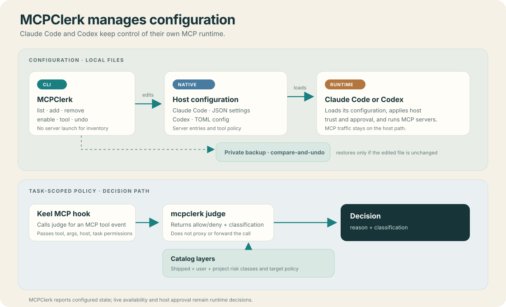

# MCPClerk

[](https://github.com/hishamalward/mcpclerk/actions/workflows/ci.yml)


**Manage MCP configuration for Claude Code and Codex.** MCPClerk is a local CLI for inspecting configured servers, editing native host settings, keeping an operation catalog, and checking task-scoped MCP calls.

MCPClerk edits configuration; Claude Code and Codex still run MCP servers and own runtime approval and trust. It does not proxy tool traffic or launch servers during inventory. A listed entry is configured state, not proof of a live connection.



## Install

MCPClerk requires Python 3.10 or newer. From a checkout:

```sh
python -m pip install .
mcpclerk --help
```

For development, install `.[dev]` and run `python -m pytest`.

## Start here

`list` inspects native configuration without launching MCP processes. Its inventory omits commands, URLs, environment values, and headers:

```sh
mcpclerk list
mcpclerk list --host codex --project /path/to/project
```

To add a server, put its native definition in a JSON file and choose a host and scope. For example, `server.json` can contain a stdio definition:

```json
{"command":"npx","args":["-y","@modelcontextprotocol/server-filesystem","/path/to/project"]}
```

Then add it to a user configuration:

```sh
mcpclerk add files --host claude --scope user --file server.json
```

The command reports an undo transaction ID. Use `mcpclerk undo ID` to restore the previous file if it has not changed since. See the [command guide](docs/commands.md) for project scopes, per-tool settings, catalog policy, and task judging.

Catalog policy is separate from host approval. `mcpclerk judge` reads one JSON request from standard input and returns a classification and decision without echoing its arguments. Keel calls it for MCP tool events; the decision uses declared task permissions and project target policy.

Claude Code and Codex remain the runtime authorities for native configuration and project trust. Managed settings, project trust, session flags, and live connections can change effective availability beyond what a local file inventory can establish.

## License

MIT.
