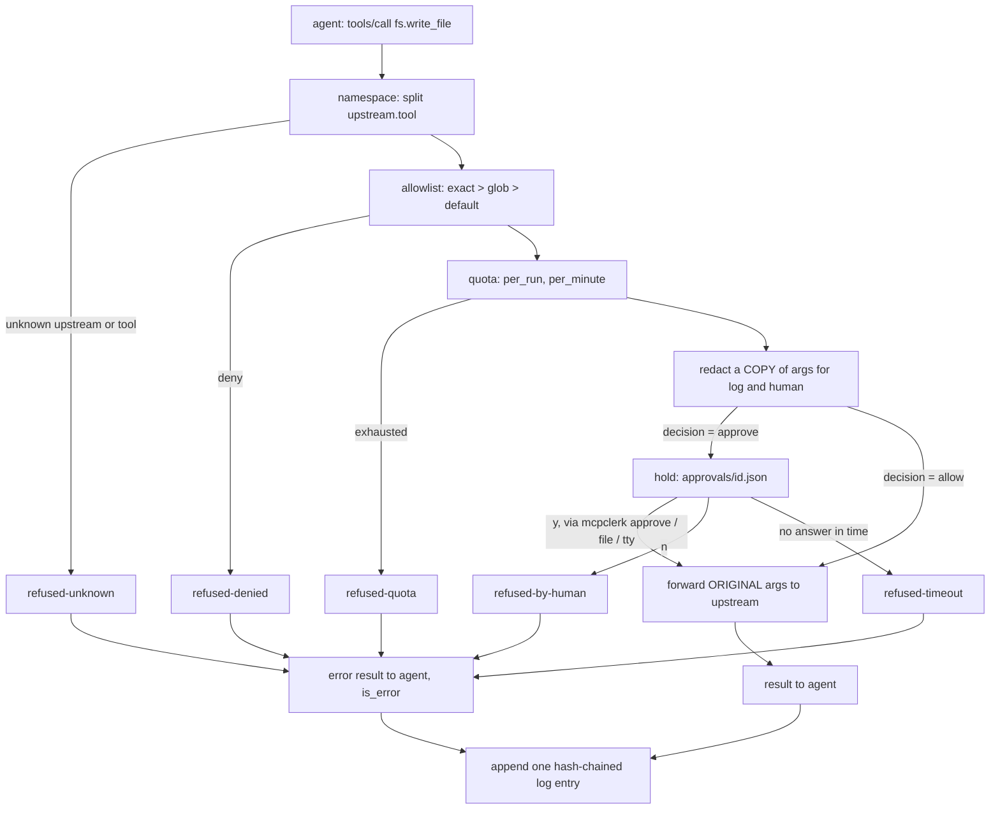

# How mcpclerk works, for the person who has to defend it

You are taking this over. This is the tour in the order a tool call moves, plus the answers you will need in a room where someone asks "why not just...". Under 1,500 words; the tables and the diagram are extra.

## The story in one paragraph

An agent on MCP can call any tool its servers expose, as often as it likes, with any arguments, and nothing records it in a form anyone can audit. The enterprise question is not whether the agent can do the job; it is **what is it allowed to do, who approved the dangerous parts, and what did it actually do.** mcpclerk is a small MCP server that sits between the agent and the real servers and answers those three with code: a per-tool allowlist (deny by default), a hold-for-a-human step on write-class tools, per-tool quotas, redaction of secret-looking arguments before anything is logged or shown, and an append-only, hash-chained audit log with a `verify` command. It deliberately does not do identity, a UI, remote approval channels, or anything that needs an upstream patched. From the demo log in `examples/audit.demo.jsonl`: 10 entries, 7 calls, 1 approved, 2 refused (one by policy, one by quota), chain intact.

## One call through the pipeline

Every path ends at the log. That is the invariant the tests check most often: a refusal is not a silent drop, it is an entry with a `decision` starting with `refused-`.

## The code, in call order

**`cli.py`, `_serve`.** Loads the policy, opens the log, opens `/dev/tty` if there is one, builds the `Proxy` and runs the low-level server over `stdio_server()`. Decision: the proxy uses the SDK's low-level `Server` with `on_list_tools` / `on_call_tool` callbacks, not the decorator API, because a proxy does not know its tools at import time; it discovers them.

**`policy.py`, `load_policy` and `Policy.resolve`.** Parses YAML, validates every key, expands `${VAR}` from the environment, and records the file's SHA-256 so a log can be tied to the policy that produced it. `resolve` returns the rule for a tool: exact name, then the longest matching glob, then `defaults.unlisted`. Decision: **deny by default**, because an unlisted tool is an unreviewed tool, and the cost of the default being wrong is asymmetric.

**`server.py`, `Proxy.start`.** Opens each upstream, lists its tools, and builds the exposed set. Tools whose decision is `deny` are left out of `tools/list`. Decision: hide rather than list-and-refuse, because an agent cannot be tempted by a tool it cannot see, and a hidden tool called by name is still refused and logged, so hiding costs nothing in enforcement.

**`server.py`, `Proxy.call_tool`.** The pipeline, top to bottom, in the order the diagram shows. Quota is checked before approval so a human is never asked to bless a call that would be refused anyway. Decision: quota is consumed by every attempt that gets past the check, including one a human later refuses, because it was a real attempt on the upstream's budget.

**`redact.py`, `Redactor.redact`.** Returns a redacted deep copy; key rules replace whole values, value rules replace matches, and the replacement names the rule (`[REDACTED:kv-secret]`). Decision: **redact for the log, not for the upstream**, because the proxy must never change what the tool does; the test `test_upstream_receives_unredacted_args` sends a fake API key through a `secret_sink` tool that echoes its input, and asserts the upstream saw it and the log did not.

**`approval.py`, `request_approval`.** Writes `approvals/<id>.json` with the redacted arguments and polls it every 250 ms, racing a terminal prompt if a terminal exists, until an answer or the timeout. Decision: **the file queue is the mechanism and the terminal is a client of it**, because the MCP SDK starts stdio servers in a new session (`start_new_session=True`), so a proxy launched by an agent has no terminal; `mcpclerk approve` is a second-terminal client of the same queue. Timeout is a refusal, because silence on a write means no.

**`quota.py`, `QuotaBook.try_acquire`.** A per-run counter and a 60-second sliding window per tool, with the clock injected so tests do not sleep. Decision: refused calls are not counted, so a stuck agent hammering a tool does not push the window further out.

**`upstream.py`, `Upstream.open` / `call`.** One SDK `Client` per upstream for the life of the run; `stdio_client(params)` already satisfies the SDK's `Transport` protocol, so stdio and HTTP upstreams differ only in construction. Decision: fail loudly if the policy sets HTTP headers the SDK cannot send, rather than silently send none.

**`audit.py`, `AuditLog.append` and `verify`.** Each entry gets `seq`, `prev_hash` and `hash = sha256(prev_hash + "\n" + canonical(entry))`; the file is opened `O_APPEND` and fsynced per entry; `verify` recomputes everything and also checks that `run-end` claims the number of entries the run actually has. Decision: **a hash chain rather than signatures**, because the threat is quiet editing by someone with write access, not forgery by an outsider; a chain makes every edit visible and costs nothing to run.

## The controls table

| Control | Prevents | Cannot prevent | Tested by |
|---|---|---|---|
| Allowlist, deny by default | use of any tool nobody reviewed | a wrong `allow` in the policy | `test_policy.py`; pipeline test calling a hidden tool by name |
| Approval per call, timeout = refusal | an unsupervised write | an approver who does not read; `--approve-session` is the deliberate, loudly logged exception | `test_approval.py` (file, terminal, timeout, refuse); pipeline tests |
| Quotas per tool | runaway loops, volume turning cheap into expensive | spreading a loop across tools or restarts | `test_quota.py`; `test_quota_exhaustion` |
| Redaction of what is logged and shown | secrets in the log or on the approver's screen | a secret shaped like nothing on the list (extend the patterns) | `test_redact.py`; `test_upstream_receives_unredacted_args` |
| Hash-chained log, `verify` | quiet edits, deletions, reordering, truncation of a finished run | a full rewrite from genesis; truncation of a run killed mid-way | `test_audit.py`: edit, delete, reorder, truncate |

## Interview answers

**Why a proxy and not hooks inside the agent?** Hooks live in the agent's process and are only as trustworthy as the agent's configuration, which the agent can often edit. A proxy is a separate process with its own policy file and its own log, and it works for any MCP client, not one vendor's hook API. The price is one more process and a namespaced tool name.

**How is this different from the gateways that already exist?** Lasso's mcp-gateway, IBM's context-forge and Docker's MCP Gateway are platforms: registries, auth, plugins, observability. mcpclerk is about 900 lines with one dependency beyond the SDK, five controls, and a log you can verify with one command. It claims smallness and verifiability, not novelty.

**What happens when approval times out, and why is that a refusal?** The call is not forwarded, the agent receives `refused-timeout` as a readable error, and the log records it. The proxy cannot tell "no" from "not yet", and the safe reading of silence on a write is no; an agent that wants the call can ask again and a human can answer.

**How would you extend this to per-user identity?** Put an identity on the request (a header on HTTP transport, or an authenticated client session), make the policy keyed by principal as well as tool, and record `approved_by` as a real identity rather than a channel. The pipeline does not change; the policy resolver and the approval record gain one dimension.

**What would an attacker do first, and what does this not stop?** Call a hidden tool by name: refused and logged. Then look for an `allow` that is too broad, or a secret the redactor does not recognise: the policy is your judgement, and the pattern list is finite. With write access to the log file, rewrite the whole chain from genesis: the chain is not a signature. An external anchor for the daily head hash is the next step.

**How does this relate to the framework and to ToilScan?** Same instinct at three layers. ToilScan bounds blast radius on a developer tool's writes (preview by default, explicit apply, a journal). The framework bounds it on an agent's code changes (spec first, gates, hooks). mcpclerk bounds it on an agent's tool calls: allowed, approved, recorded.

## Self-check

1. A tool is listed in the policy as <code>approve</code> and the human never answers. What does the agent see, and what is in the log?

An error result with <code>is_error: true</code> and the text <code>mcpclerk: refused-timeout fs.write_file: no approval within 120s</code>. The log has one entry with <code>decision: refused-timeout</code>, <code>outcome: not-forwarded</code>, and <code>held_ms</code> equal to the timeout.

2. The policy allows <code>read_*</code> and denies <code>read_media_file</code>. Which wins?

The exact name. Resolution is exact, then longest glob, then default; <code>read_media_file</code> is denied and is not listed to the agent.

3. Why does the upstream receive a password that the log shows as <code>[REDACTED:kv-secret]</code>?

Because redaction is applied to a copy used for the log and the approval prompt only. Changing what the upstream receives would change what the tool does, and a proxy that changes tool behaviour is no longer a proxy. The test that proves it sends a secret through a tool that echoes its input.

4. Someone edits one character in line 4 of the log. What does <code>verify</code> print, and what if they delete line 4 instead?

<code>FAIL at line 4: hash does not match entry content (edited)</code>. If deleted: <code>FAIL at line 4: seq 5 but expected 4 (missing or reordered entry)</code>. If they delete the last call of a finished run, <code>run-end</code>'s count no longer matches and verify reports truncation.

5. Why does <code>mcpclerk approve</code> exist when the proxy already prompts on the terminal?

Because the proxy usually has no terminal. MCP clients spawn stdio servers in a new session, so <code>/dev/tty</code> cannot be opened. The file queue is the real mechanism; the in-process prompt only works when a human starts the proxy by hand, and <code>mcpclerk approve</code> is the same prompt running in a terminal that exists.

